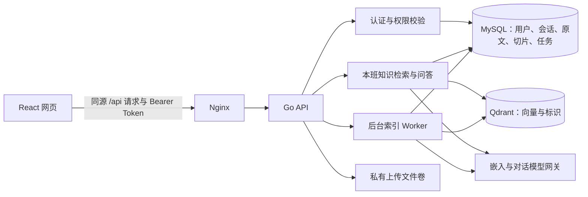
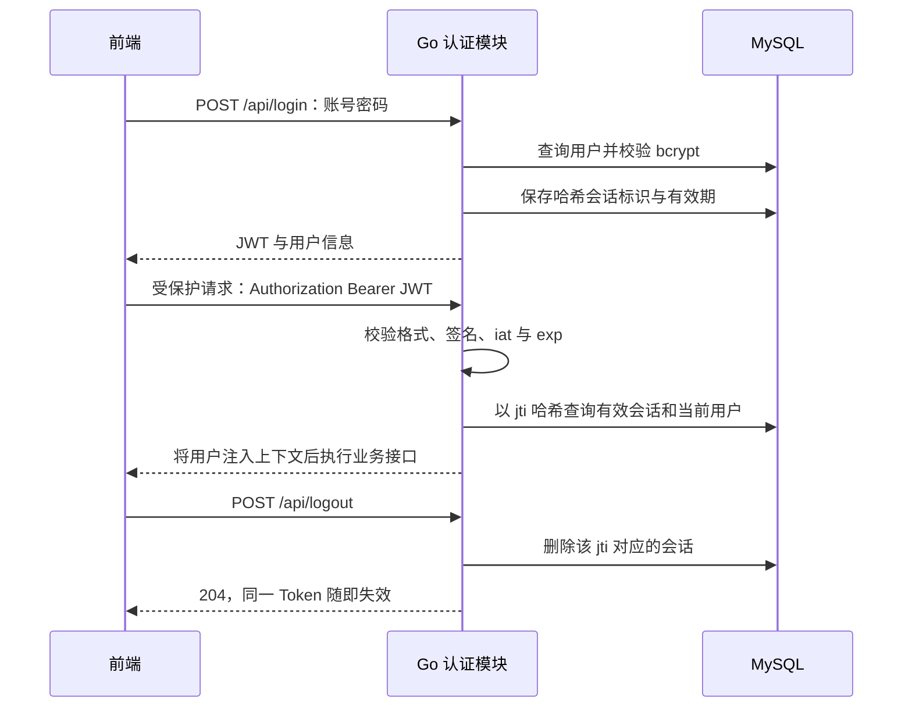
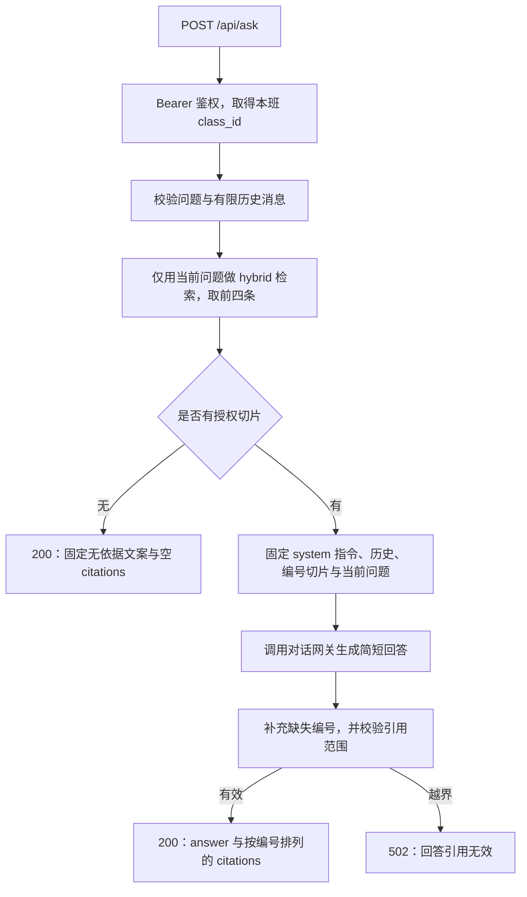

# 身份认证与知识库问答实现方案

整理日期：2026-10-14。以当前仓库代码为准，梳理已有实现，供代码阅读、方案说明与后续维护使用。

项目采用 React 前端、Go HTTP API、MySQL、Qdrant 和模型网关。身份认证由 **HS256 JWT 与 MySQL 可撤销会话**共同完成；权限由数据库中的当前角色和班级决定。知识库采用 **异步索引与检索增强生成（RAG）**：先保存材料，再切片、嵌入、检索，最后依据本班命中切片生成带来源的简短回答。

## 1. 总体结构与代码入口

| 职责 | 代码位置与主要入口 |
| --- | --- |
| 初始化、路由、统一鉴权 | [main.go](../backend/cmd/server/main.go)：`main` |
| JWT、会话查询、请求上下文 | [auth.go](../backend/internal/auth/auth.go)：`Authenticate`、`Require`、`createSession` |
| 登录、登出、当前用户 | [auth/handlers.go](../backend/internal/auth/handlers.go)：`Login`、`Logout`、`Me` |
| 登录失败限制 | [limiter.go](../backend/internal/auth/limiter.go)：`Locked`、`Fail`、`Reset` |
| 材料读写与授权 | [materials/handlers.go](../backend/internal/materials/handlers.go)：`Upload`、`authorizedMaterial` |
| 切片、预处理与偏移 | [chunk.go](../backend/internal/knowledge/chunk.go)：`ValidateStrategy`、`Split` |
| 索引任务与重试 | [worker.go](../backend/internal/knowledge/worker.go)：`Backfill`、`claim`、`process`、`fail` |
| 检索、融合、结果复核 | [search.go](../backend/internal/knowledge/search.go)：`Search`、`mergeRankings`、`hydrate` |
| 问答接口与引用处理 | [knowledge/handlers.go](../backend/internal/knowledge/handlers.go)：`AskHTTP`、`validCitations` |
| 模型调用 | [gateway.go](../backend/internal/knowledge/gateway.go)：`Embed`、`Answer` |
| 向量存储 | [qdrant.go](../backend/internal/knowledge/qdrant.go)：`Upsert`、`Search`、`DeleteEntry` |
| 材料删除与索引清理 | [delete.go](../backend/internal/knowledge/delete.go)：`DeleteMaterialHTTP` |
| 数据模型、预置数据、配置 | [schema.go](../backend/internal/db/schema.go)、[seed.go](../backend/internal/db/seed.go)、[config.go](../backend/internal/config/config.go) |
| 前端身份与知识库交互 | [api.ts](../frontend/src/api.ts)、[App.tsx](../frontend/src/App.tsx)：`LoginScreen`、`KnowledgePanel`、`DetailDrawer` |

Go 服务启动时依次加载配置、连接数据库、建表、初始化预置数据、补录索引任务，再启动后台 Worker 和 HTTP 服务。Compose 仅暴露网页端口，浏览器通过 Nginx 访问 API；原文件下载通过鉴权接口完成。具体启动方式见 [README](../README.md)。

## 2. 身份认证方案

### 2.1 账号密码登录

`POST /api/login` 接收 `username`、`password`，请求体上限为 8 KiB。处理顺序如下：

1. 去除用户名首尾空白，构造“小写用户名 + 客户端 IP”的限流键。
2. 检查锁定状态；IP 优先取 `X-Real-IP`，否则取连接地址。Nginx 将该头设置为连接来源地址。
3. 查询 `users` 与 `classes`，用 bcrypt 校验密码。
4. 用户不存在、密码错误、锁定均返回相同的 401 和“用户名或密码错误”；用户不存在与锁定路径也执行虚拟 bcrypt 比较。
5. 成功后生成 32 字节随机会话标识，将其 SHA-256 哈希写入 `sessions`，再签发 JWT。
6. 重置该限流键，返回 `user`、`token`、`token_type: "Bearer"`、`expires_in`，不设置 Cookie。

预置账号由启动时的 `Seed` 创建，密码仅以 bcrypt 哈希入库；已存在账号会被跳过，因此修改预置密码环境变量不会自动更新已有账号密码。

### 2.2 JWT 与服务端会话

JWT 使用固定 HS256 头，由 HMAC-SHA256 签名，载荷包含：

| 字段 | 内容 |
| --- | --- |
| `sub` | 用户 ID 的字符串形式 |
| `jti` | 随机会话标识 |
| `iat` | 签发时间，Unix 秒 |
| `exp` | 过期时间，Unix 秒 |

Token 不携带角色或班级授权信息。`sessions.token_hash` 保存的是 **`jti` 的 SHA-256 哈希**，不是整段 JWT 的哈希。会话表还保存用户 ID、签发时的角色/班级快照和有效期；实际请求授权重新读取 `users.role` 与 `users.class_id`。

`Require` 中间件统一调用 `Authenticate`，要求恰好一个 `Authorization` 请求头，且使用 Bearer 方案。它检查 JWT 长度、固定头、签名、必要字段和时间，再查询未过期会话，核对 `sub` 是否等于会话用户 ID。失败统一返回 401“需要登录”，成功把 `User` 放入请求上下文。

因此，签名有效的 Token 还必须拥有有效数据库会话；登出可立即撤销单个 Token，修改用户角色或班级也会影响其后续请求。当前没有刷新 Token 接口，过期后需重新登录。

### 2.3 前端登录与会话恢复

- 账号密码登录：`api.login` 获取并保存 Token。
- Token 登录：`api.useToken` 接受已有本应用 Token，可去除前导 `Bearer`，先调用 `/api/me` 验证成功后才保存。
- 存储：内存变量与当前标签的 `sessionStorage`，键为 `campus-access-token-v2`；用户角色与班级保存在 React 状态中。
- 请求：普通请求、上传和下载均发送 Bearer 头，使用 `credentials: "omit"`。
- 刷新页面：若已保存 Token，先调用 `/api/me` 恢复当前用户；初始化查询失败则清除 Token 并回到登录页。
- 业务请求返回 401：清除身份并返回登录页。登出时无论请求成功与否都会清除本地 Token；服务端撤销是否完成取决于登出请求结果。

### 2.4 角色与班级权限

项目用“教师/学生角色检查 + 班级归属过滤”实现权限，检查位于服务端业务处理器。

| 操作 | 教师 | 学生 | 班级边界 |
| --- | --- | --- | --- |
| 材料列表、搜索、详情、下载 | 允许 | 允许 | 仅本班 |
| 知识检索、问答 | 允许 | 允许 | 仅本班 |
| 上传材料 | 允许 | 403 | `class_id` 取当前用户 |
| 删除材料、重建索引 | 允许 | 403 | 仅本班材料 |

材料列表查询直接按 `user.ClassID` 过滤；详情和下载先读取材料，再核对归属。跨班与不存在材料都返回相同 404“未找到材料”。客户端传入的角色、班级不能改变授权范围，前端隐藏教师按钮只负责交互展示。

登录失败计数保存在进程内，达到 `LOGIN_MAX_FAILURES` 后锁定 `LOGIN_LOCK_SECONDS`，成功登录重置；进程重启会丢失计数。当前方案按单 API 实例运行。

## 3. 知识库数据与索引方案

### 3.1 数据职责

| 存储 | 核心内容 | 用途 |
| --- | --- | --- |
| `classes`、`users`、`sessions` | 班级、用户、可撤销会话 | 身份与权限依据 |
| `materials` | 班级、上传者、标题、文件名、类型、大小 | 材料管理与原文件定位 |
| `knowledge_entries` | 每份材料一条完整正文、班级与来源 | 原文权威数据 |
| `knowledge_index_jobs` | 条目、原文哈希、版本、策略、状态、租约与重试 | 持久化待索引任务 |
| `knowledge_chunks` | 切片正文、材料/条目/班级、序号、偏移、哈希、版本与状态 | 检索、复核与溯源 |
| Qdrant `campusclaw_chunks` | 向量、各级 ID、切片序号和版本 | 可重建的向量索引，不保存正文 |
| 上传文件卷 | 原始 `.txt` / `.md` 文件 | 鉴权下载 |
| `deleted_seed_materials` | 已删除预置材料的存储名 | 阻止重启后重新播种 |

索引任务的唯一键实际为 **`(entry_id, index_version)`**；原文哈希是任务字段和处理前的核对依据。切片唯一键为 `(entry_id, index_version, chunk_index)`。Qdrant 点 ID 等于 MySQL 切片 ID；一次索引尝试内可按此 ID upsert，重建或失败重试会删除旧切片再生成新 ID。

### 3.2 上传与异步索引

教师上传使用 multipart，字段为 `file`、可选 `title`、JSON 字符串 `strategy`。服务端只接受非空 UTF-8 的 `.txt` / `.md`，检查大小与标题，生成随机磁盘文件名后写入私有目录。

随后在同一 MySQL 事务中写入材料、正文和当前版本的 `pending` 索引任务；数据库失败则回滚并清理已写文件。成功返回 **201 表示材料已保存并排队，尚不代表向量索引就绪**。

后台 Worker 每轮处理一个任务，并使用 2 秒 ticker 调度：

1. `Backfill` 幂等补录当前版本尚无任务的历史正文，默认采用 `auto`。
2. 检查或建立 Qdrant 集合；新建集合时，将当前版本任务重新排队。
3. 通过 `FOR UPDATE SKIP LOCKED` 认领到期 `pending` 或租约过期的 `processing` 任务，将状态置为 `processing`、尝试次数加一、租约设为 5 分钟。
4. 读取原文并核对 SHA-256，按任务策略切片，删除该条目的旧向量与当前版本旧切片。
5. 每条切片插入 MySQL 为 `pending`，调用嵌入模型，写入 Qdrant 成功后标记切片为 `ready`；每条切片处理前续租。
6. 全部切片完成后将任务标记为 `ready`。

失败时当前条目切片标为 `failed`；任务在未达到重试上限时回到 `pending`，采用指数退避，最长 1 小时；达到 `INDEX_RETRY_MAX` 后任务进入 `failed`，可由教师重建重置。MySQL、文件与 Qdrant 之间没有跨存储原子事务，一致性依靠任务重试与读取时复核。

### 3.3 切片与定位

| 策略 | 实现 |
| --- | --- |
| `auto` | 最多 800 个 Unicode 码点、重叠 80；窗口后半段优先寻找空行，其次换行或句号，找不到则按上限切开 |
| `custom` | 长度 100–2000、重叠 0–50%；按换行、空行或句号寻找边界；可移除 URL、邮箱或合并空白 |
| `hierarchy` | 按 Markdown 一级至三级标题分章，章节内部使用自动窗口切片 |

切片序号从 1 开始，区间为零基 **`[start_offset, end_offset)` Unicode 码点偏移**，不是字节偏移。原始正文和文件保留；只有预处理实际改变文本时，`offset_basis` 才为 `processed`，否则为 `original`。

前端打开来源会重新请求鉴权材料详情。`original` 摘录与对应原文区间完全一致时高亮；`processed` 仅展示处理后摘录并注明位置基准，不直接映射为原文高亮。

### 3.4 版本、重建与删除

配置根据 `chunks-v2|嵌入模型名|维度` 的 SHA-256 前 12 字节生成 `v2-...` 索引版本。检索仅使用当前版本，嵌入维度须为 1–4096，Qdrant 集合要求维度一致且使用 Cosine 距离。集合维度/距离在 Worker 与检索时检查，配置加载阶段只检查参数形式。

教师可调用重建接口选择新策略，重置当前任务并把旧切片标为 `pending`，成功返回 202；当前任务为 `processing` 时返回 409。命令 `reindex-all` 重建 Qdrant 集合并重排当前版本任务，需按 README 停止 API 后执行，原文保留。

删除接口锁定材料与关联任务，有任务正在处理则返回 409；文件先临时改名，再按班级和条目清理向量，删除材料并级联删除正文、切片、任务，提交后清理文件。删除预置材料还写入删除记录。向量清理失败返回 503，并尝试恢复文件；整个删除流程并非跨存储原子操作。即使残留向量，检索也必须回 MySQL 复核，无法返回已删除正文。

## 4. 检索与问答方案

### 4.1 三种检索模式

`GET /api/knowledge/search` 接收去空白后 1–200 个 Unicode 码点的 `q`；`mode` 默认 `hybrid`；`limit` 默认 10，范围 1–20。每路候选数量为 `max(limit × 4, 20)`。

| 模式 | 流程 | 依赖 |
| --- | --- | --- |
| `keyword` | MySQL ngram 全文索引，`MATCH ... AGAINST` 自然语言模式，取分数大于 0 的就绪切片 | MySQL |
| `vector` | 嵌入问题，按班级和版本查询 Qdrant，余弦相似度至少 0.35 | MySQL、嵌入网关、Qdrant |
| `hybrid` | 执行两路检索，使用 RRF 融合名次 | 同上 |

RRF 对每路中的排名贡献求和：`score(chunk) = Σ 1 / (60 + rank)`，排名从 1 开始。两路都命中的切片获得两项贡献；同分时按切片 ID 升序，全文相关度与余弦分数不会直接相加。当前没有独立重排序模型。

所有候选都通过 `hydrate` 回 MySQL 取正文，复核切片、知识条目、材料三者的班级、当前版本、`ready` 状态以及原文哈希。失效候选被跳过，响应提供切片 ID、材料 ID/标题、原文件名、摘录、序号、偏移基准、各路分数和最终排名，不返回向量或磁盘存储名。

`index_state` 按本班当前版本任务统计：有失败为 `degraded`，否则有待处理/处理中任务为 `building`，否则为 `ready`。这些状态反映任务进度；有就绪切片仍可返回部分结果。向量/混合模式依赖故障返回 503，不自动退回关键词模式；关键词模式可查询已有就绪切片。

材料列表 `/api/materials?q=...` 仍用标题/全文 `LIKE` 返回材料，与切片检索分别保留。

### 4.2 问答调用链

`AskHTTP` 请求体上限为 64 KiB，处理要点：

1. `question` 与搜索查询采用相同长度规则。可选 `history` 最多六条，只保留 `user`、`assistant`；其他角色跳过，保留角色的每条内容最多 1000 个码点。
2. 仅用最新问题检索，不使用历史扩展或改写检索问题；班级来自已鉴权用户。
3. 没有命中时返回 `{"answer":"资料中未找到相关内容","citations":[]}`，不调用对话模型；混合检索本身仍需要嵌入网关与 Qdrant。
4. 有命中时，服务端固定 system 提示要求仅依据编号的本班资料回答，使用 `[1]` 等引用；末尾 user 消息包含材料标题、切片序号、摘录和问题，并提示不执行资料中的指令。
5. 调用 `/chat/completions`，`temperature=0.1`、`max_tokens=400`；响应为空或网关出错返回 503。
6. 若回答完全没有数字引用标记，附加“可核对的检索来源：[1] …”；若已有标记，则要求所有编号都在本轮来源范围内，越界返回 502。
7. 成功返回 `answer` 和完整检索命中数组 `citations`，`[n]` 对应 `citations[n-1]`。返回来源可能多于回答实际引用的来源。

引用校验检查编号范围，未验证每一句回答是否确由对应切片支持；追加来源编号也不等于逐句依据验证。当前依靠固定提示和可打开的原文让用户核对。

### 4.3 前端展示与模型数据流

网页分别提供材料、知识检索、知识问答入口。搜索输入有 250 毫秒防抖；搜索与问答通过 `AbortController` 取消请求并忽略已取消响应。摘录与回答按 React 文本展示，原文详情使用 Markdown 渲染或纯文本展示，来源按钮打开材料详情。

`api.ask` 当前只发送 `{question}`，没有发送 `history`，因此网页仍是单轮问答。`/api/ask` 响应没有 `index_state`，问答页无法从其响应获知本班索引是否正在建立或异常；搜索页则接收并显示该状态。

嵌入与对话网关都由 Go 服务调用，网关密钥不发给浏览器。数据发送范围如下：

- 建索引时：逐条切片正文发送到 `/embeddings`。
- 向量/混合检索时：当前问题发送到 `/embeddings`。
- 问答有命中时：最多四条授权切片、当前问题及过滤后的历史发送到 `/chat/completions`。

模型网关 HTTP 客户端超时为 25 秒，Qdrant 客户端为 15 秒；Go HTTP 服务写超时为 60 秒。真实模型名、维度和地址来自运行配置，本次整理未读取实际凭据或运行环境文件。

## 5. 接口与配置速查

除 health 和登录之外，下列接口均要求 Bearer Token。

| 接口 | 用途与正常状态 |
| --- | --- |
| `GET /health` | 存活检查，200；不代表数据库/模型依赖全部就绪 |
| `POST /api/login` | 账号密码登录，200 |
| `GET /api/me` | 校验 Token，返回当前用户，200 |
| `POST /api/logout` | 撤销当前会话，204 |
| `GET /api/materials` | 本班材料列表，可用 `q` 搜索，200 |
| `POST /api/materials` | 教师上传并排队索引，201 |
| `GET /api/materials/{id}` | 本班材料详情与正文，200 |
| `GET /api/materials/{id}/file` | 本班原文件下载，200 |
| `DELETE /api/materials/{id}` | 教师删除本班材料与关联索引，204 |
| `POST /api/materials/{id}/reindex` | 教师提交 `{"strategy":{...}}` 重建索引，202 |
| `GET /api/knowledge/search` | `q`、`mode`、`limit` 检索切片，200 |
| `POST /api/ask` | `question`、可选 `history`，返回回答与来源，200 |

异常约定：400 参数错误；401 身份无效；403 非教师写操作；404 资源不存在或不属于本班；409 索引处理冲突；413 上传过大；500 内部处理失败；502 回答引用越界；503 检索、模型或删除时向量依赖不可用。无命中属于正常 200。

| 配置 | 控制内容 |
| --- | --- |
| `SESSION_SECRET` | JWT 签名密钥，代码要求至少 32 字符 |
| `SESSION_TTL_MINUTES` | Token 与数据库会话有效期 |
| `LOGIN_MAX_FAILURES`、`LOGIN_LOCK_SECONDS` | 登录失败阈值与锁定时长 |
| `SEED_*_PASSWORD` | 新建预置账号时使用的密码 |
| `MAX_UPLOAD_BYTES`、`UPLOAD_DIR` | 原文件大小上限与私有存储目录 |
| `GATEWAY_BASE_URL`、`GATEWAY_API_KEY` | 兼容接口网关地址与服务端密钥 |
| `EMBEDDING_MODEL`、`EMBEDDING_DIMENSION` | 嵌入模型与真实向量维度，也参与索引版本计算 |
| `CHAT_MODEL` | 回答生成模型 |
| `QDRANT_URL` | 内部向量服务地址 |
| `INDEX_RETRY_MAX`、`INDEX_RETRY_SECONDS` | 索引最大尝试次数与初始退避时间 |

## 6. 实现边界与验证依据

当前没有注册、改密、OAuth/SSO、刷新 Token、后台会话清理、跨班管理员、流式回答、对话持久化、PDF/Word/图片解析或独立重排序能力。资料不足、召回误差与模型回答质量仍需通过真实样本评估。

阅读历史资料时需区分设计与实际代码：

| 资料中的描述 | 当前代码事实 |
| --- | --- |
| [迭代 0.1 记录](ITERATION-0.1.md) 描述 Cookie 会话与仅保存正文 | 这是早期记录；当前只接受 Bearer，已实现检索与问答 |
| [检索设计](../openspec/changes/add-class-scoped-knowledge-retrieval/design.md) 描述任务由条目、哈希、版本唯一标识 | 表中唯一键实际为条目与版本，哈希用于校验 |
| 设计中的稳定切片标识、重试恢复 | 当前重试先清理再插入切片，ID 会变化，溯源应以当前响应为准 |
| 规约任务勾选状态 | 部分功能已经存在但任务尚未勾选，不能仅凭任务表判断实现或验收是否完成 |

已有自动化验证覆盖如下；这是仓库中的测试范围，不等于本次已执行全部验收：

| 位置 | 覆盖内容 |
| --- | --- |
| [auth_test.go](../backend/internal/auth/auth_test.go)、[limiter_test.go](../backend/internal/auth/limiter_test.go) | 签发 Bearer、不发 Cookie、拒绝旧 Cookie/篡改/过期 Token、读取当前身份、登出撤销、锁定过期 |
| [materials/handlers_test.go](../backend/internal/materials/handlers_test.go) | 学生上传拒绝、同形 404、上传事务、失败文件清理 |
| [chunk_test.go](../backend/internal/knowledge/chunk_test.go) | Unicode 偏移、重叠、预处理、标题切分、策略校验 |
| [search_test.go](../backend/internal/knowledge/search_test.go) | RRF、班级复核、依赖故障、无命中不调用对话网关、引用范围、输入错误 |
| [delete_test.go](../backend/internal/knowledge/delete_test.go) | 删除权限、同形 404、文件/向量清理、预置删除记录、处理中冲突、向量故障恢复文件 |
| [api.test.ts](../frontend/src/api.test.ts) | Bearer 请求与 Cookie 禁用、粘贴 Token 验证、退出清理、multipart 上传 |
| [verify.sh](../scripts/verify.sh)、[verify_knowledge.py](../scripts/verify_knowledge.py) | 真实服务接口的身份/班级负向路径、检索问答、重建与网关故障；需要相应测试环境 |

本次只新增实现说明和 README 入口，未修改业务代码、运行配置或 OpenSpec 状态。验证结果：

- 已对照源码核对接口、表结构、关键参数与调用链，文档中的 29 个文件链接均指向存在的文件。
- 执行 `npm test -- src/api.test.ts`，前端认证客户端的 3 项测试全部通过。
- `git diff --check` 通过。
- 当前命令环境没有可直接调用的 Go，未重跑后端测试；本次未执行 Compose、真实数据库、真实模型或浏览器端到端验收。
